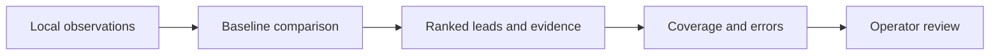
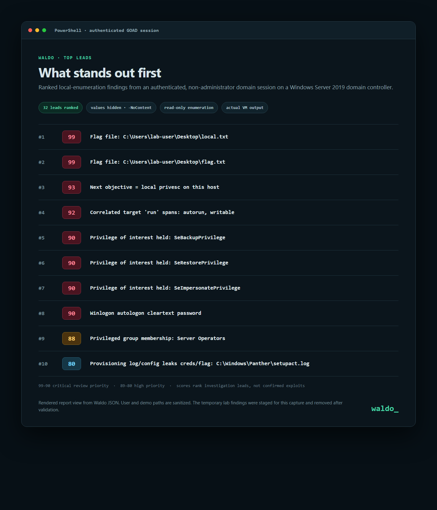

# Waldo — anomaly-led local enumeration

Waldo is an OSCP-oriented Windows/Linux enumeration tool that compares local
observations with conservative host baselines and ranks leads for manual review.
It helps answer **what stands out on this host, and why is it worth investigating?**

Two standalone scripts: PowerShell for Windows and Bash for Linux. No installed
agent, service, or AI backend is required. Waldo gathers evidence for an operator;
it does not exploit findings or reuse discovered credentials to log in to services.

**“Where's the thing that doesn't belong?”** is the practical question behind
Waldo. It looks for files, services, users, paths and other artifacts outside a
conservative Windows or Linux installation, then ranks them for investigation.
That approach is especially useful in training labs. It may also help on servers,
but has not been broadly validated there and is likely less useful on heavily
customized production workstations, where legitimate software adds baseline noise.

The author used Waldo without issue during a successful OSCP exam attempt in
summer 2026. That is one real-world use, not an exam-policy or compatibility claim.

[Quick start](#quick-start) · [Workflow](#workflow-and-modes) ·
[Output](#interpreting-output) · [Requirements](#requirements) ·
[Limits](#operating-behavior-and-limitations) · [Tests](#validation) ·
[Feature reference](docs/REFERENCE.md)

## Quick start

Clone or download the repository and review the script before running it on an
authorized assessment host. Start in your normal user context: elevation changes
what can be read and how writable-path findings are ranked.

```bash
git clone https://github.com/digihax/waldo.git
cd waldo
```

Windows, from the checkout:

```powershell
.\waldo.ps1 -Light -NoContent
.\waldo.ps1 -Light -NoContent -JsonOut .\waldo.json
.\waldo.ps1 -List
```

Linux, from the checkout:

```bash
bash waldo.sh --light --no-content
bash waldo.sh --light --no-content --json ./waldo.json
bash waldo.sh --list
```

Use your environment's approved PowerShell execution procedure if local policy
blocks a reviewed script. Administrator/root is not required for a first pass;
denied access is part of the result, not a reason to change host permissions.

## Workflow and modes



Checks cover identity, users, services, startup entries, processes, paths,
permissions and application artifacts. See the [feature reference](docs/REFERENCE.md).
Baselines reduce familiar noise; they are not an allowlist of trustworthy software.

| Mode | Windows | Linux | Behavior |
|---|---|---|---|
| Full (default) | `-Full` | `--full` | Includes deeper sweeps |
| Medium | `-Medium` | `--medium` | Skips deeper sweeps |
| Light | `-Light` | `--light` | Skips deeper sweeps and log mining |

The default is **full plus deep**, not the light examples above. Use `-Only`/`--only`
and `-Skip`/`--skip` to select classes; the list option prints exact names.
Windows additionally has an `ad` class. Text output uses `-OutFile` or `-o`;
JSON uses `-JsonOut` or `--json`. Choose a fresh output path: existing files can
be overwritten. Verify report existence, size and JSON validity after collection.

## Interpreting output

| Tag | Meaning |
|---|---|
| `[!]` | Non-standard observation to review |
| `[!!]` | Anomalous item with a writable/modifiable condition in the current context |
| `[x]` | Access denied or a coverage gap |
| `[i]` | Supporting context |

### Example ranked output



_Rendered report view from an authenticated GOAD Windows Server 2019 run. The
lab findings were staged for the capture and removed afterward; the username and
demo paths are sanitized, and content values were suppressed with `-NoContent`._

The footer combines ranked leads with coverage and collector skip/error details.
Scores prioritize review; they are **not** vulnerability confirmations or
probabilities. Check the cited path, consumer and current permissions manually.
Partial coverage, timeouts and interruptions must not be interpreted as clean runs.

Reports can contain sensitive evidence. `-NoContent`/`--no-content` reduces content
inspection but is not a universal redaction mode. Review console, text and JSON
before sharing; JSON is not guaranteed to be a complete or secret-free inventory.

## Requirements

- **Windows:** Windows PowerShell and available Windows/.NET APIs. Focused logic
  tests were checked with Windows PowerShell 5.1 and PowerShell 7 on Windows;
  that does not certify every Windows version, update or server role.
- **Linux:** Bash and utilities such as `find`, `grep`, `sed`, `awk`, `stat` and
  `sort`. Additional commands such as `getcap`, `ss`, `timeout`, `openssl` and
  document readers enable specific checks. It is not dependency-free.
- Missing tools or permissions reduce coverage. Check the recorded outcomes;
  a missing finding does not prove that a check ran successfully.

## Operating behavior and limitations

- No exploitation, payload deployment, credential spraying or network target
  scanning. Waldo does not intentionally modify services, tasks, registry settings
  or target permissions. Temporary working files and requested reports are written:
  read-only enumeration does not mean zero filesystem activity.
- Windows can perform domain policy commands and multiple directory/LDAP reads.
  Skipping the `ad` class does not guarantee zero domain traffic. Linux can run
  noninteractive privilege-context checks, including `doas -n id` when available.
  These activities may produce audit events; this is not a stealth guarantee.
- Optional local-secret decoding is off by default. Keep assessment evidence
  private; discovered values are not validated against services.
- Mounted-root/loot modes select collection paths; they are not a sandbox. Process
  only trusted assessment inputs in a disposable environment. Document extraction
  is not a hardened parser for malicious archives or decompression bombs.
- Deadlines apply to selected collectors, not the whole run. Cancellation and
  descendant-process cleanup are not comprehensive guarantees. Do not set Linux
  `WALDO_DEADLINE=0` expecting an immediate timeout: it disables GNU timeout.
- Unknown platforms, custom packages and server roles can produce false positives
  and missed findings. Linux/Windows checks are related, not identical.
- Existing report writers have limited failure signaling. A success line alone is
  not proof of a complete saved report; validate the file. Unusual control bytes
  in source data may also affect Linux JSON serialization.
- OSCP-oriented does not mean approved by an exam provider. Check current exam
  rules independently before use.

## Validation

See [tests/README.md](tests/README.md) for commands, test boundaries and detached
manifest verification. Synthetic fixtures do not establish live-host coverage.

The maintenance pass verified 192 Linux fixture assertions, seven Linux release
checks and focused Windows logic suites. Full live-host/domain and distribution
matrix validation remain separate from those results.

## Contributing and license

Report the script revision, platform, mode, expected result and a minimal sanitized
reproduction. Do not attach real credentials or raw host reports. See
[CONTRIBUTING.md](CONTRIBUTING.md). MIT license and existing attribution are
preserved in [LICENSE](LICENSE).
